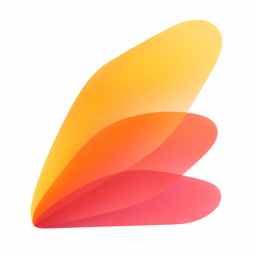
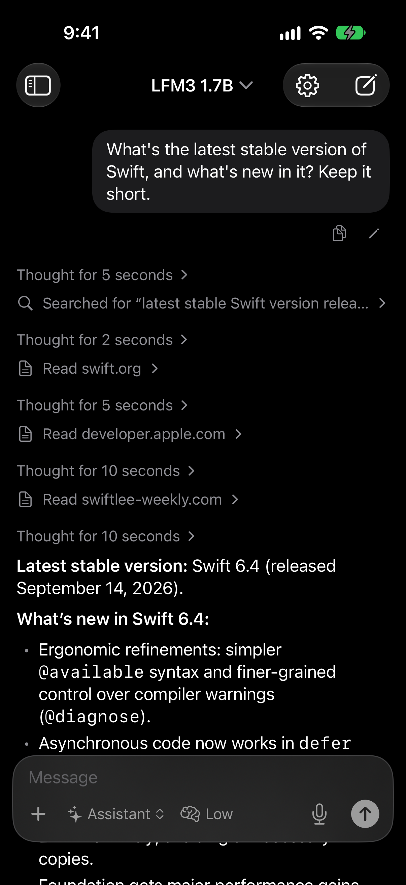
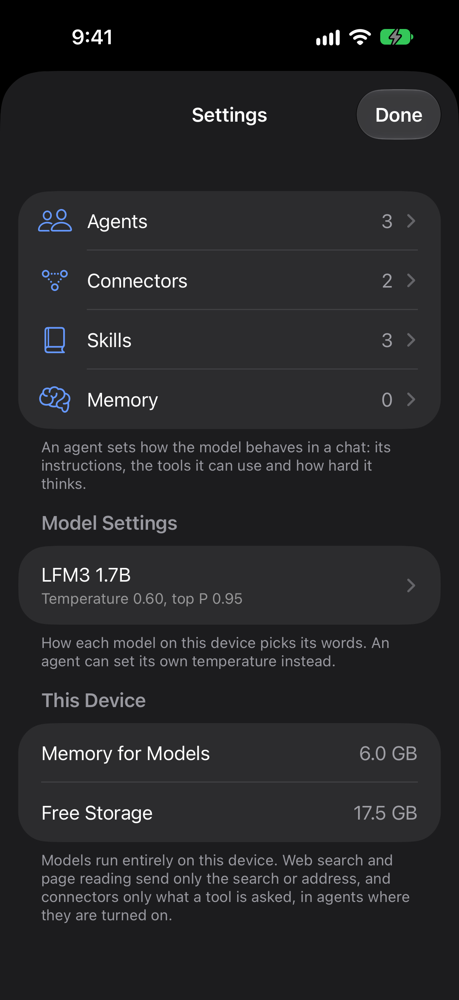
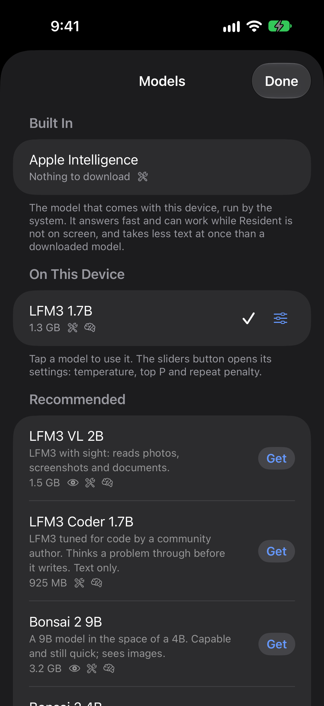

<div align="center">



# Resident: Fully local AI in the iPhone

**A fully local AI agent for iPhone.**

Small models, run on the device, inside a harness built to get real work out of them.


&nbsp;&nbsp;
&nbsp;&nbsp;


</div>

Resident runs open models on your iPhone with [MLX](https://github.com/ml-explore/mlx-swift) and gives them what a modern agent has: tools, web search, a code sandbox, skills, memory, and connectors to the services you use, signed in with OAuth. Nothing you type leaves the phone unless a tool you switched on sends it.

Yes, it is another LLM chat app. The difference is under the hood.

## 🤔 Why I built this

I kept hearing how good small local models had become, and with a phone that finally had the memory for them, I wanted to see what they could do.

So I tried the apps. Some ran models well and gave them no tools at all. Others had tools, but none of the context engineering a small model needs to cope with a real MCP server and its dozens of tool definitions. The model was rarely the weak part. The app around it was.

I build AI assistants for a living, so I built the app I wanted, with everything I know about harness engineering in it: tools and skills disclosed only when a task needs them, memory, MCP connectors with proper sign-in, and a context budget tight enough for a 2B model.

The goal is simple. Whatever the best model is that fits on an iPhone, the app and the harness should never be what holds it back. I think this is the best way to do useful work with a local model on an iPhone today, and I want to keep pushing how far these small models can go.

## ⚡️ Quick start

You need a Mac with Xcode, [XcodeGen](https://github.com/yonaskolb/XcodeGen), and an iPhone. On-device models need a real phone: MLX does not run in the iOS simulator.

```sh
git clone https://github.com/jflick58/resident.git
cd resident
brew install xcodegen
cp Config/Local.xcconfig.example Config/Local.xcconfig
```

Open `Config/Local.xcconfig` and fill in your Apple team ID, a bundle ID of your own, and the name of your phone. That file is ignored by git, so none of it ends up in the repository.

```sh
./run-device.sh
```

That builds the app, installs it on your phone and opens it. Pick a model in the app, wait for the download, and ask it something.

> 👆 No phone to hand? `./run-sim.sh` runs the app in the simulator, where it can talk to a model server on your Mac, such as Ollama at `http://localhost:11434/v1`.

## 🧠 The harness

With small models, the harness matters more than the model. This is what Resident does about that.

| | What it does | Why it matters for a small model |
|---|---|---|
| 🧰 | **Tools on demand.** A connector is one line in the prompt until the model opens it. Then it gets the handful of tools that fit the request, not all of them. | Linear's 27 tools cost about 13,000 tokens declared at once. Opened on demand, the same tasks ran in under 3,000. |
| 📚 | **Skills.** Saved instructions for one kind of task, loaded only when a task matches. The model can propose new ones and update old ones. | Know-how without a longer prompt. |
| ✂️ | **Trimmed tool definitions.** Descriptions and schemas are cut to what a model needs to make the call. | Opened tools went from 5,500 tokens to under 3,000, and tasks got a third faster. |
| 🔒 | **Constrained tool calls.** For a model that writes its calls as JSON (Qwen 3, the Llama family), a grammar admits only a declared tool and valid arguments once a call starts. The other formats (LFM3, Qwen 3.5, Bonsai) are parsed, and a call that cannot be read goes back to the model as an error. | No malformed calls to recover from where the grammar applies, and none lost where it does not. |
| 🧮 | **A context budget.** Old tool results are shortened first, then old turns dropped. Long pages are ranked against the question and only the best passages kept. | A long chat or a long web page does not crowd out the question. |
| ♻️ | **Incremental prompts.** Each step feeds the model only what it has not seen. | Steps after the first start in a fraction of a second. |
| 💭 | **Thinking control.** Off, Low, Medium or High, from the chat itself. | Spend tokens on thought only when the task needs it. |
| 🔁 | **Resumable turns.** The chat is saved after every step, and a turn cut off by iOS carries on where it stopped. | Long jobs survive the app going to the background. |

The full detail, part by part with the file to read for each, is in [docs/HARNESS.md](docs/HARNESS.md).

## ✨ What it can do

- **Run models on the device.** A curated list with a fit check for your phone, or any MLX model from a Hugging Face link.
- **Use your services.** Add any MCP server by address, or pick from the suggested list: GitHub, Linear, Notion, Atlassian, Sentry, Hugging Face and DeepWiki. Sign-in happens in the system browser, and tokens stay in the Keychain.
- **Work with your phone.** Calendar and Reminders, read and written on the device.
- **Work on files.** The tools a coding agent has (list, search, read, edit, write) on the app's folder in the Files app: put files in, take out what the model wrote. With GitHub connected, the model can clone a repository into it, change the code and open a pull request.
- **Search and read the web.** Search and page reading run on the phone, with no account or key.
- **Run code.** A JavaScript sandbox with no network and no file access.
- **Read what you attach.** Photos, PDFs and documents, with text recognition for scans.
- **Remember.** A small memory you can read, edit, switch off or wipe.
- **Take dictation.** A speech model on the device turns your voice into the message.
- **Run from Shortcuts.** *Ask Resident* and *Wait for Resident* put the agent inside your automations, with the app closed.
- **Use a bigger model when you want one.** Point it at any OpenAI-compatible server, such as Ollama on your own machine.

Agents tie it together. An agent is a set of instructions with a switch for each tool and connector, a thinking level and a reply length, so you shape the assistant without a wall of settings.

## 🤖 Models

These are in the app's library. The fit check tells you which ones your phone can run before you download anything.

| Model | Maker | Good for |
|---|---|---|
| LFM3 1.7B | Liquid AI | Small, fast, and the most dependable with tools in our tests |
| LFM3 VL 2B | Liquid AI | LFM3 that can read photos and documents |
| LFM3 Coder 1.7B | AJ Gonzalez | LFM3 tuned for code by a community author |
| Qwen 3.5 4B | Alibaba | The best all-rounder: strong with tools, sees images |
| Qwen 3.5 2B | Alibaba | Fast and light, still handles tools and images |
| Qwen 3 4B / 1.7B | Alibaba | Reliable tool use; the 1.7B suits older phones |
| Bonsai 2 9B / 4B / 2B | PrismML | Large models squeezed small; all see images |
| Bonsai 2 27B | PrismML | The largest that runs on a phone: it fills a 12 GB iPhone, so it is slow there |
| Gemma 4 E2B / E4B | Google | Natural writing and good vision |

Apple's on-device model can be used too, where the phone has it.

## 📏 What we measured

Claims about harnesses are cheap, so these are the numbers behind ours. Each is one run on a Mac with the real model and the same harness the app uses, so a gap of a task or two is noise. The task counts are with LFM3's 4-bit build.

| Test | Result |
|---|---|
| 17 general tasks, 4 built-in tools plus 13 connectors, LFM3 1.7B | **17 of 17**, with a first prompt of about 1,200 tokens (4,700 with every tool declared) |
| 12 tasks against Linear's real tool definitions, LFM3 1.7B, tools opened on demand | **12 of 12** |
| The same 12 tasks with all tools declared up front | 10 of 12, with an 18,600-token prompt and 97 seconds a task |
| Speed on an iPhone Duo, LFM3 1.7B, app on screen | About 65 tokens a second with the 6-bit build the app offers there, 76 to 95 with the 4-bit |
| LFM3 1.7B's builds against the weights as trained, on 42 prompts from the suite | The 4-bit build picks the same next token **89.5%** of the time, 5-bit 93.8%, 6-bit **97.3%**, 8-bit 98.6%. The app offers the 6-bit where it fits with a full-length chat and the 4-bit elsewhere |

`harness-spike` in `HarnessMLX` reruns these on your own Mac, and `spike-results/` holds the raw results. [`evals/README.md`](evals/README.md) covers the suite of 423 cases and the comparison of builds.

## 🛠 Building and testing

| Command | What it does |
|---|---|
| `./run-device.sh` | Build, install and open on your phone |
| `./run-sim.sh` | Build, run in the simulator and take a screenshot |
| `cd HarnessKit && swift test` | The harness's unit tests, in a few seconds |
| `xcodegen generate` | Regenerate `Resident.xcodeproj` from `project.yml` |

To run a real model through the harness on a Mac and score it:

```sh
cd HarnessMLX
xcodebuild -scheme harness-spike -destination 'platform=macOS,arch=arm64' \
  -derivedDataPath ../DerivedData -skipMacroValidation build
../DerivedData/Build/Products/Debug/harness-spike LiquidAI/LFM3-1.7B-MLX-4bit --thinking low
```

| Path | What is there |
|---|---|
| `App/` | The SwiftUI app: chat, models, agents, connectors, skills, memory, Shortcuts actions |
| `HarnessKit/` | The harness, with no MLX dependency: agent loop, tools, skills, MCP client and sign-in |
| `HarnessMLX/` | The on-device provider on MLX, and `harness-spike` |
| `Config/` | Build settings; your own go in the untracked `Local.xcconfig` |
| `docs/` | How the harness works |
| `site/` | The website (Jekyll) |

> 🔔 GitHub does not let an app register itself, so one-tap GitHub sign-in needs an OAuth app of your own. `Config/Local.xcconfig.example` says how to add its client ID. No secret is involved.

## 🚧 Where it stands

Resident is young, and it is honest about its limits.

- **Not on the App Store yet.** For now you build it yourself.
- **Built and tuned on an iPhone Duo.** Other recent iPhones should work with the smaller models; the fit check will tell you.
- **Background runs are slower.** iOS gives an app off screen much less GPU time, and Shortcuts stops waiting for one action after a few minutes. *Wait for Resident* exists to carry a long job across that limit.
- **Gmail and Google Calendar are waiting on Google.** Its hosted servers only answer accounts in a developer preview. Calendars from a Google account added in iOS Settings already work through the on-device Calendar tools.
- **MCP covers tools only**, over the web. No resources, prompts or servers that need a local process.

## 🏆 Contributing

Issues and pull requests are welcome, and so are results. If you run `harness-spike` with a model that is not in the table, or find a connector a small model cannot handle, open an issue and say what you saw. That is exactly the kind of case the harness is here to fix.

If Resident is useful to you, a ⭐️ helps other people find it.

## ⚠️ License

Resident is free and open source software under the [Apache 2.0 License](LICENSE).
